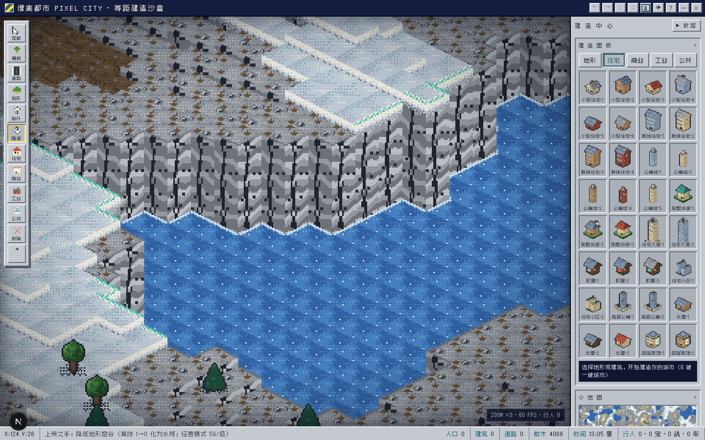
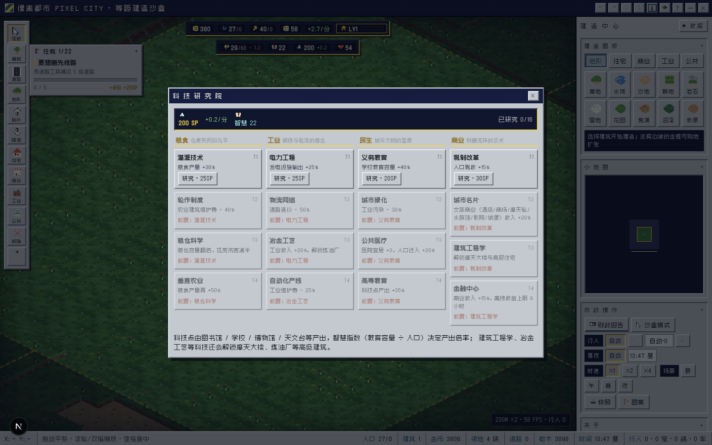
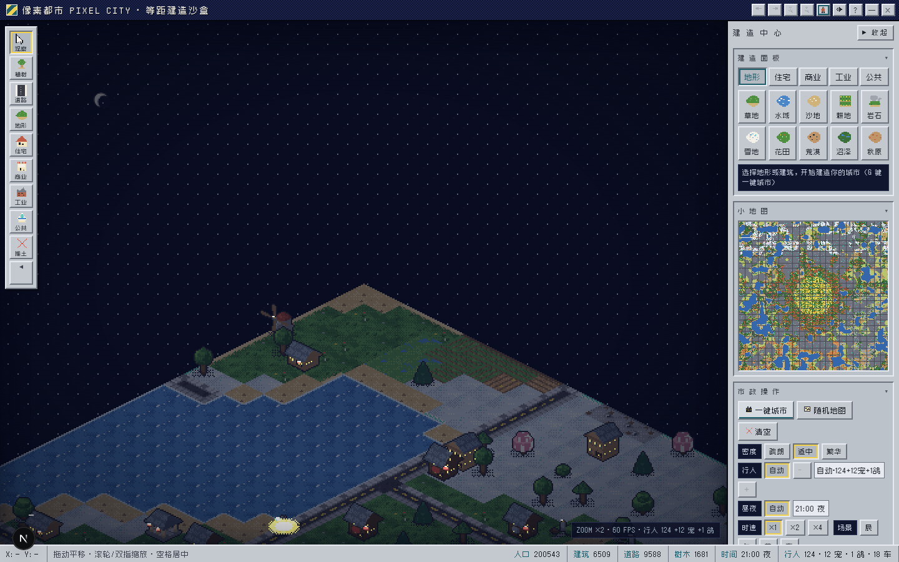

# 像素都市 PIXEL CITY

一款运行在浏览器里的**复古等距城市模拟经营游戏**。上帝视角从一块荒地起步：修路建房、人口迁入、电力供需、幸福度治理、购地扩张；也可随时切入沙盒自由建造。所有建筑均由代码程序化建模，经自研离线预渲染管线光栅化为透明精灵图集——不做实时 3D、不用 Blender，追求 SimCity 2000 / PC98 时代的精致像素观感。








## 特性

- **经营模式（Tycoon）**：从一块 32×32 荒地白手起家——380G 启动资金，市政厅自带 40MW 电力，修路建房耗金币；税收/商业/工业三路收入 **− 设施维护费**（净收入才是真功夫，入不敷出会赤字），人口渐进迁入且**街道行人密度随实际人口增长**，岗位供需与就业率，电力供需断电惩罚，幸福度 = 宜居 55% + 粮食安全 25% + 就业 20%，57 种建筑随市政厅 12 级逐步解锁，22 环任务链引导直至「都市之父」，**拆除设施回收 50% 造价**（道路/树木近全额），离线收益（35% 速上限 4 小时，金融中心科技可提升至 8 小时）
- **民生指数体系**：**粮仓**（温室/筒仓/风车产粮，市民耗粮，缺粮触发饥荒→幸福崩溃/人口流失）、**智慧指数**（图书馆/学校/博物馆教育容量覆盖人口）、**科技点**（教育设施产出 × 智慧加成）、**宜居度**（设施供需 + 污染 + 供电的环境指数）——四项指标在第二条 HUD 实时呈现
- **科技研究院**：四分支（粮食/工业/民生/商业）× 四层级共 16 项科技——从灌溉技术、电力工程到垂直农业、金融中心；科技决定发展方向，冶金工艺/建筑工程学等科技解锁炼油厂与摩天大楼
- **真实起伏地形**：每格 0-13 级海拔高度场——山脊噪声生成山脉/丘陵/谷地/岸线，崖壁立面按地表分风格绘制（草皮土层/岩层理/积雪檐/沙层），雪线以上皑皑峰顶；**抬升/降低工具**（0/-键）造山填海（经营模式 5G/级，填海 12G）；山坡建房自动整地（3G/格），行人车辆双线性插值贴地爬坡，小地图海拔明暗分层
- **领地扩张**：全图 256 块领地覆盖迷雾，点击金色虚线框购买相邻地块（环距递增 140G×1.62^ring，越远越贵），迷雾下林木隐藏、购地即揭示
- **沙盒模式**：随时与经营模式双向切换（进度独立存档），自由建造、一键城市、随机地图无限制
- **自研离线预渲染管线**：程序化建模 → 固定 2:1 等距正交投影 → 软件光栅化 → 66 色有限色板 + Bayer 8×8 有序抖动 → 透明精灵图集，启动时批量生成，可一键导出 PNG 图集
- **256×256 超大地图**：10 种地形（草地/水域/沙滩/耕地/岩石/雪原/花田/荒漠/沼泽/秋原），气候带随机生成，旧存档自动居中迁移（v2 平地档兼容）
- **58 类 120+ 变体建筑**：住宅/商业/工业/公共四大分区，从町屋、居酒屋、千本鸟居到摩天轮、电视塔、体育场；新增**图书馆**（廊柱山花知识殿堂，教育 +35 / 科技 +2/分）；经营模式专属市政厅（金顶钟塔 + 旗帜）
- **一键生成城市**：道路网格 + 距离/角度分区 + 地标布置 + 密度三档（疏朗/适中/繁华，沙盒模式）
- **智能行人系统 v4**：三种体型（成人/儿童/长者）× 14 套配色 × 双肤色，九大职业（警察/邮递员/学生/主厨/慢跑者/医生/消防员/环卫工/游客），遛狗与流浪猫狗、广场鸽群（啄食/受惊急窜）、结伴出行，BFS 寻路、路口停顿、夜间回家；车辆沿路网行驶，数量 0-300 可调
- **精琢材质**：窗台线 + 窗下空调外机 + 半帘亮灯、玻璃幕墙斜向天光与深色横带、逐砖色差砖墙、逐瓦变化坡顶、平屋顶伸缩缝与积水、草地草簇小花、水面波光、窨井盖/补疤/龟裂路面
- **昼夜循环**：暮色暖光、夜幕压暗、万家灯火、路灯光晕、霓虹招牌、车头灯光束，时钟可调（×1/×2/×4 时速）
- **DOS/PC98 复古观感**：Win3.1 银灰斜面面板、扫描线 + CRT 暗角色差、Zpix 中文像素字体、PC 喇叭方波音效
- **全端适配**：桌面拖拽/滚轮缩放，移动端单指平移/双指捏合缩放 + 底部抽屉，全部面板可收缩
- **完整玩法工具**：24 步撤销/重做、localStorage 3 槽位存档 + 自动存档、PNG 快照导出、小地图

## 快速开始

```bash
# 安装依赖（bun 或 npm 均可）
bun install        # or: npm install

# 启动开发服务器
bun run dev        # or: npm run dev

# 打开 http://localhost:3000
```

## 操作

| 操作 | 桌面 | 移动端 |
|------|------|--------|
| 放置/使用工具 | 左键点击/拖拽 | 单指点击/拖拽 |
| 平移地图 | 右键/空格拖拽 | 单指拖拽 |
| 缩放 | 滚轮 | 双指捏合 |
| 购买领地（经营） | 点击迷雾金色虚线框 | 同左 |
| 财政报告（经营） | 点击市政厅或 HUD 等级钮 | 顶栏图表钮 |
| 科技研究院（经营） | 点击 HUD「科/智」指标 | 同左 |
| 抬升/降低地形 | `0` / `-` 键或工具条 | 底部工具条 |
| 一键城市（沙盒） | 市政面板或 `G` 键 | 底部抽屉 → 市政 |

常用快捷键：`1-8` 工具切换 · `0/-` 抬升/降低 · `G` 一键城市 · `Ctrl+Z / Ctrl+Y` 撤销/重做 · `Esc` 取消选择

## 技术架构

```
src/lib/pixelcity/
├── palette.ts      # 66 色和谐色板 + 29 条渐变色阶（ramp）
├── rng.ts          # 种子随机 / 值噪声 / 分形噪声
├── geo.ts          # 等距 2:1 正交投影 + 建模原语（盒体/坡顶/棱锥/圆台…）
├── patterns.ts     # 面纹理库（窗格/砖/幕墙/霓虹/看台人群…）
├── softrender.ts   # 软件光栅化器（扫描线填充 + 色板量化抖动 + 轮廓 + 夜光模式）
├── terrain.ts      # 10 种地面精灵 + 悬崖立面精灵（土/岩/沙/雪/旱 × 双侧 × 13 级）
├── b_*.ts          # 58 类建筑程序化建模（res/com/ind/civ/extra/more/dusk）
├── catalog.ts      # 建筑目录注册 + 精灵图集管理（日间/夜光双渲染）
├── map.ts          # 256² 地图数据层（高度场 + 抬升/降低 + RLE 序列化 v3 + 撤销栈）
├── citygen.ts      # 一键城市生成器（路网 + 分区 + 地标 + 密度参数）
├── actors.ts       # 行人/车辆/宠物/鸽群系统（BFS 寻路 + 三体型精灵 + 九职业 + 夜间行为）
├── tycoon.ts       # 经营引擎（经济 + 粮仓 + 科技树 16 项 + 智慧/宜居指数 + 任务链）
├── engine.ts       # 渲染引擎（高度感知画家算法 + 崖壁 + 昼夜管线 + 高度拾取 + 输入 + 小地图）
├── audio.ts        # PC 喇叭方波音效合成
└── icons.ts        # 28 个字符画像素图标
```

纯客户端应用：无后端、无数据库、无外部图片/模型资源——每一帧像素都来自代码。

## 许可

项目代码仅供学习交流。
