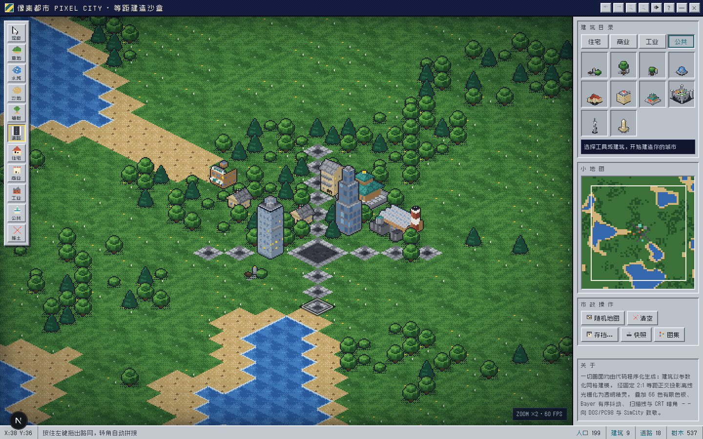
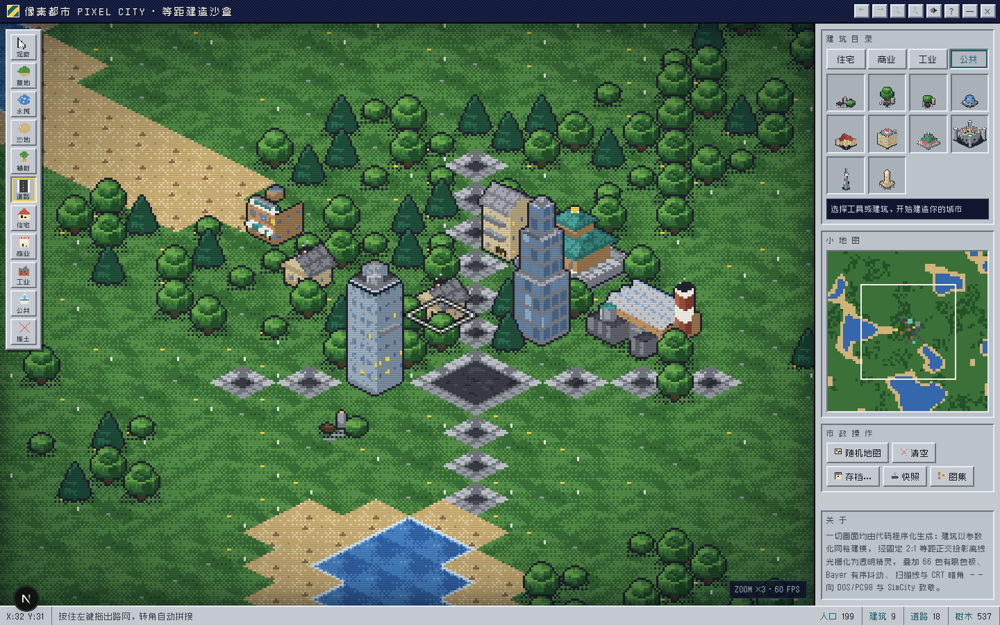

# 像素都市 PIXEL CITY

一款运行在浏览器里的**复古等距城市建造沙盒**。所有建筑均由代码程序化建模，经自研离线预渲染管线光栅化为透明精灵图集——不做实时 3D、不用 Blender，追求 SimCity 2000 / PC98 时代的精致像素观感。





## 特性

- **自研离线预渲染管线**：程序化建模 → 固定 2:1 等距正交投影 → 软件光栅化 → 66 色有限色板 + Bayer 8×8 有序抖动 → 透明精灵图集，启动时批量生成，可一键导出 PNG 图集
- **256×256 超大地图**：10 种地形（草地/水域/沙滩/耕地/岩石/雪原/花田/荒漠/沼泽/秋原），气候带随机生成，旧存档自动居中迁移
- **57 类 120+ 变体建筑**：住宅/商业/工业/公共四大分区，从町屋、居酒屋、千本鸟居到摩天轮、电视塔、体育场
- **一键生成城市**：道路网格 + 距离/角度分区 + 地标布置 + 密度三档（疏朗/适中/繁华）
- **智能行人系统**：三种体型（成人/儿童/长者）× 14 套配色 × 双肤色，BFS 寻路、路口停顿、夜间回家；车辆沿路网行驶，数量 0-300 可调
- **昼夜循环**：暮色暖光、夜幕压暗、万家灯火、路灯光晕、霓虹招牌、车头灯光束，时钟可调（×1/×2/×4 时速）
- **DOS/PC98 复古观感**：Win3.1 银灰斜面面板、扫描线 + CRT 暗角色差、Zpix 中文像素字体、PC 喇叭方波音效
- **全端适配**：桌面拖拽/滚轮缩放，移动端单指平移/双指捏合缩放 + 底部抽屉，全部面板可收缩
- **完整玩法工具**：24 步撤销/重做、localStorage 3 槽位存档 + 自动存档、PNG 快照导出、小地图

## 快速开始

```bash
# 安装依赖（bun 或 npm 均可）
bun install        # or: npm install

# 启动开发服务器
bun run dev        # or: npm run dev

# 打开 http://localhost:3000
```

## 操作

| 操作 | 桌面 | 移动端 |
|------|------|--------|
| 放置/使用工具 | 左键点击/拖拽 | 单指点击/拖拽 |
| 平移地图 | 右键/空格拖拽 | 单指拖拽 |
| 缩放 | 滚轮 | 双指捏合 |
| 一键城市 | 市政面板或 `G` 键 | 底部抽屉 → 市政 |

常用快捷键：`1-8` 工具切换 · `G` 一键城市 · `Ctrl+Z / Ctrl+Y` 撤销/重做 · `Esc` 取消选择

## 技术架构

```
src/lib/pixelcity/
├── palette.ts      # 66 色和谐色板 + 29 条渐变色阶（ramp）
├── rng.ts          # 种子随机 / 值噪声 / 分形噪声
├── geo.ts          # 等距 2:1 正交投影 + 建模原语（盒体/坡顶/棱锥/圆台…）
├── patterns.ts     # 面纹理库（窗格/砖/幕墙/霓虹/看台人群…）
├── softrender.ts   # 软件光栅化器（扫描线填充 + 色板量化抖动 + 轮廓 + 夜光模式）
├── terrain.ts      # 10 种地面精灵（无缝平铺 + 海岸过渡 + 道路 16 掩码拼接）
├── b_*.ts          # 57 类建筑程序化建模（res/com/ind/civ/extra/more/dusk）
├── catalog.ts      # 建筑目录注册 + 精灵图集管理（日间/夜光双渲染）
├── map.ts          # 256² 地图数据层（RLE 序列化 v2 + 撤销栈）
├── citygen.ts      # 一键城市生成器（路网 + 分区 + 地标 + 密度参数）
├── actors.ts       # 行人/车辆系统（BFS 寻路 + 三体型精灵 + 夜间行为）
├── engine.ts       # 渲染引擎（画家算法 + 昼夜管线 + 输入 + 小地图）
├── audio.ts        # PC 喇叭方波音效合成
└── icons.ts        # 22 个字符画像素图标
```

纯客户端应用：无后端、无数据库、无外部图片/模型资源——每一帧像素都来自代码。

## 许可

项目代码仅供学习交流。
