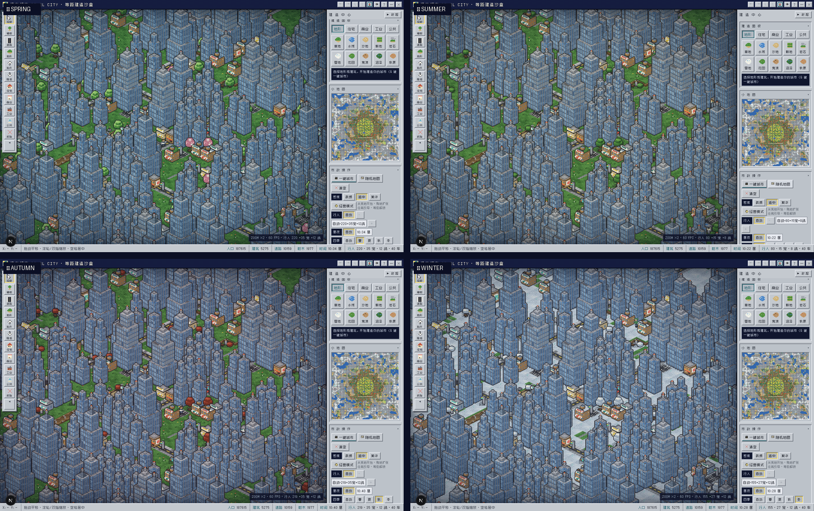
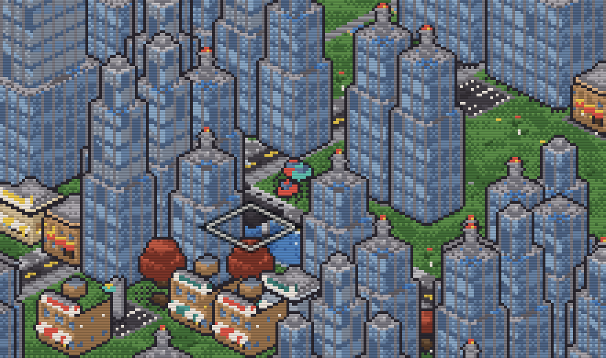

# 像素都市 PIXEL CITY

一款运行在浏览器里的**复古等距城市模拟经营游戏**。上帝视角从一块荒地起步：修路建房、人口迁入、电力供需、幸福度治理、购地扩张；也可随时切入沙盒自由建造。所有建筑均由代码程序化建模，经自研离线预渲染管线光栅化为透明精灵图集——不做实时 3D、不用 Blender，追求 SimCity 2000 / PC98 时代的精致像素观感。








## 特性

- **四季轮转（v6）**：春樱/夏绿/秋红/冬雪随时钟自动更替（每季 4 分钟×1，随档持久化）——树冠四套换装（阔叶春新绿、秋红叶、冬积雪；松柏雪顶；樱花春日限定粉冠，春季公园一半概率樱树点景）、冬季大地积雪 + 水面封冻（青白冰面 + 冰裂纹 + 岸冰积雪）、春季樱花瓣飘落粒子、四季整体色调；**经济联动**——春粮 +15%、秋收 +25%、冬粮 −40% 取暖用电 +18%、夏旅游商业 +8% 空调 +8%，换季即时提示；沙盒可手动切季
- **跨水大桥（v6）**：道路工具拖过水面自动架桥（15G/格，物流网络 −40%）——桥板抬升与岸上路面齐平、背侧护栏 + 立柱、朝前钢梁剖面、混凝土桥墩 + 水面投影，行人车辆双线性贴高自然上桥，拆桥返还 3G/格；任务「跨水长虹」与成就「跨海长虹」等你征服天堑
- **水务系统（v6）**：新增水塔（半径 9 格 · 供 260 人，LV2）与净水厂（半径 20 格 · 供 2200 人，LV6，双沉淀池/刮泥桥/加氯罐/架空管建模）——供水覆盖率 = 覆盖人口占比 × 容量/人口，市政厅自带水井（半径 6）供早期定居；缺水拖累幸福与迁入，HUD 水滴芯片 + 城市志第十维指数条实时监控
- **经营模式（Tycoon）**：从一块 32×32 荒地白手起家——380G 启动资金，市政厅自带 40MW 电力，修路建房耗金币；税收/商业/工业三路收入 **− 设施维护费**（净收入才是真功夫，入不敷出会赤字），**可调税率 0-20%**（高税多金却伤幸福，低税惠民而囊中羞涩），人口渐进迁入且**街道行人密度随实际人口增长**，岗位供需与就业率，电力供需断电惩罚，幸福度 = 宜居 26% + 粮食 16% + 就业 13% + 供水 12% + 环境 10% + 交通 8% + 健康 8% + 安全 7% + 税率情绪 + 事件/天气/季节，60 种建筑随市政厅 12 级逐步解锁，27 环任务链引导直至「都市之父」，**拆除设施回收 50% 造价**（道路/树木近全额），离线收益（35% 速上限 4 小时，金融中心科技可提升至 8 小时）
- **动态天气系统（v5）**：晴/多云/雨/雪四态自动轮转（渐入渐出过渡），雨丝/雪花屏幕粒子 + 云影飘过山脊 + 雨天海面涟漪闪斑 + 全局色调（雨天冷蓝压暗/雪天亮白偏冷）；**天气联动经济**——春雨润物粮食 +30%，雪天路滑交通 −20%，晴天生意兴隆商业 +4%
- **随机事件系统（v5）**：人口 30 后机遇与灾祸不期而至——火灾/疫病/停电/暴风雨/税务风波 vs 游客潮/丰收节/科技博览会/街头艺术节/投资热潮；**设施决定命运**：消防局把火灾损失压到 20%、医院收治疫病、电力冗余避免停电；活动事件横幅实时倒计时，火灾烟柱 + 火点 + 现场标签，暴风雨强制切换雨天；财政报告「城市大事记」完整记录
- **成就系统（v5+）**：16 枚成就徽章（人口/金币/建筑/道路/科技/评级/领地/城市年龄/粮仓/供水/桥梁），城市志成就墙展示进度，解锁即提示
- **十维指数与城市评级（v4+v6）**：**粮仓**（缺粮触发饥荒）、**智慧**、**科技点**、**宜居度** + **环境**（净污染）、**健康**（医院病床覆盖）、**安全**（消防救援覆盖）、**交通**（路网密度）+ **供水**（水塔/净水厂覆盖）四项新指数；十维加权合成**城市评级**（S/A/B/C/D/E）实时勋章；第二条 HUD 芯片行（含天气与季节）实时呈现，点击「就业/评级」打开**城市志**——十维指数条 + 人口结构 + 历史曲线（每 15 秒采样，人口/金币/净收入/幸福四张复古像素图表）+ 城市年龄 + 成就墙
- **科技研究院**：四分支（粮食/工业/民生/商业）× 四层级共 16 项科技——从灌溉技术、电力工程到垂直农业、金融中心；科技决定发展方向，冶金工艺/建筑工程学等科技解锁炼油厂与摩天大楼
- **真实起伏地形（2.5D 直观化）**：每格 0-13 级海拔高度场，**每级落差 8px 更陡峭**（参照 SimCity 2000 / Caesar III 梯田）；山脊噪声幂次锐化棱线；**高原顶面海拔提亮**（越高越亮的大气光分层）+ **崖脚接地投影**（环境光阻暗带）；崖壁素材 v4：1px 亮檐口 + 强对比岩层理 + 崖脚压暗基座 + 崩积碎石堆；**抬升/降低工具**（0/-键）造山填海（经营模式 5G/级，填海 12G）；山坡建房自动整地（3G/格），行人车辆双线性插值贴地爬坡，小地图海拔明暗分层
- **领地扩张**：全图 256 块领地覆盖迷雾，点击金色虚线框购买相邻地块（环距递增 140G×1.62^ring，越远越贵），迷雾下林木隐藏、购地即揭示
- **沙盒模式**：随时与经营模式双向切换（进度独立存档），自由建造、一键城市、随机地图无限制、手动切季
- **自研离线预渲染管线**：程序化建模 → 固定 2:1 等距正交投影 → 软件光栅化 → 66 色有限色板 + Bayer 8×8 有序抖动 → 透明精灵图集，启动时批量生成，可一键导出 PNG 图集
- **256×256 超大地图**：10 种地形（草地/水域/沙滩/耕地/岩石/雪原/花田/荒漠/沼泽/秋原），气候带随机生成，旧存档自动居中迁移（v2 平地档兼容）
- **60 类 125+ 变体建筑**：住宅/商业/工业/公共四大分区，从町屋、居酒屋、千本鸟居到摩天轮、电视塔、体育场；新增**图书馆**（廊柱山花知识殿堂，教育 +35 / 科技 +2/分）与**水塔 / 净水厂**（v6 水务）；经营模式专属市政厅（金顶钟塔 + 旗帜）
- **一键生成城市**：道路网格 + 距离/角度分区 + 地标布置 + 密度三档（疏朗/适中/繁华，沙盒模式）
- **智能行人系统 v4**：三种体型（成人/儿童/长者）× 14 套配色 × 双肤色，九大职业（警察/邮递员/学生/主厨/慢跑者/医生/消防员/环卫工/游客），遛狗与流浪猫狗、广场鸽群（啄食/受惊急窜）、结伴出行，BFS 寻路、路口停顿、夜间回家；车辆沿路网行驶，数量 0-300 可调
- **精琢材质**：窗台线 + 窗下空调外机 + 半帘亮灯、玻璃幕墙斜向天光与深色横带、逐砖色差砖墙、逐瓦变化坡顶、平屋顶伸缩缝与积水、草地草簇小花、水面波光、窨井盖/补疤/龟裂路面
- **昼夜循环**：暮色暖光、夜幕压暗、万家灯火、路灯光晕、霓虹招牌、车头灯光束，时钟可调（×1/×2/×4 时速）
- **DOS/PC98 复古观感**：Win3.1 银灰斜面面板、扫描线 + CRT 暗角色差、Zpix 中文像素字体、PC 喇叭方波音效
- **全端适配**：桌面拖拽/滚轮缩放，移动端单指平移/双指捏合缩放 + 底部抽屉，全部面板可收缩
- **完整玩法工具**：24 步撤销/重做、localStorage 3 槽位存档 + 自动存档、PNG 快照导出、小地图

## 快速开始

```bash
# 安装依赖（bun 或 npm 均可）
bun install        # or: npm install

# 启动开发服务器
bun run dev        # or: npm run dev

# 打开 http://localhost:3000
```

## 操作

| 操作 | 桌面 | 移动端 |
|------|------|--------|
| 放置/使用工具 | 左键点击/拖拽 | 单指点击/拖拽 |
| 平移地图 | 右键/空格拖拽 | 单指拖拽 |
| 缩放 | 滚轮 | 双指捏合 |
| 购买领地（经营） | 点击迷雾金色虚线框 | 同左 |
| 财政报告（经营） | 点击市政厅或 HUD 等级钮 | 顶栏图表钮 |
| 科技研究院（经营） | 点击 HUD「科/智」指标 | 同左 |
| 抬升/降低地形 | `0` / `-` 键或工具条 | 底部工具条 |
| 一键城市（沙盒） | 市政面板或 `G` 键 | 底部抽屉 → 市政 |

常用快捷键：`1-8` 工具切换 · `0/-` 抬升/降低 · `G` 一键城市 · `Ctrl+Z / Ctrl+Y` 撤销/重做 · `Esc` 取消选择

## 技术架构

```
src/lib/pixelcity/
├── palette.ts      # 66 色和谐色板 + 29 条渐变色阶（ramp）
├── rng.ts          # 种子随机 / 值噪声 / 分形噪声
├── geo.ts          # 等距 2:1 正交投影 + 建模原语（盒体/坡顶/棱锥/圆台…）
├── patterns.ts     # 面纹理库（窗格/砖/幕墙/霓虹/看台人群…）
├── softrender.ts   # 软件光栅化器（扫描线填充 + 色板量化抖动 + 轮廓 + 夜光模式）
├── terrain.ts      # 10 种地面精灵 + 悬崖立面精灵（土/岩/沙/雪/旱 × 双侧 × 13 级）
├── b_*.ts          # 60 类建筑程序化建模（res/com/ind/civ/extra/more/dusk/water）
├── catalog.ts      # 建筑目录注册 + 精灵图集管理（日间/夜光双渲染）
├── map.ts          # 256² 地图数据层（高度场 + 抬升/降低 + 跨水桥标记 + RLE 序列化 v3 + 撤销栈）
├── citygen.ts      # 一键城市生成器（路网 + 分区 + 地标 + 密度参数）
├── actors.ts       # 行人/车辆/宠物/鸽群系统（BFS 寻路 + 三体型精灵 + 九职业 + 夜间行为）
├── tycoon.ts       # 经营引擎（经济 + 税率 + 十维指数/评级 + 粮仓 + 科技树 16 项 + 历史曲线 + 任务链 + 事件/成就 + 四季/水务）
├── engine.ts       # 渲染引擎（Pass1 地形层滚动缓存 + 高度感知画家算法 + 崖壁 + 昼夜管线 + 天气粒子/云影 + 四季状态机/冰面/花瓣 + 跨水桥 + 高度拾取 + 输入 + 小地图）
├── audio.ts        # PC 喇叭方波音效合成
└── icons.ts        # 41 个字符画像素图标（含天气四态 + 四季 + 水务）
```

纯客户端应用：无后端、无数据库、无外部图片/模型资源——每一帧像素都来自代码。

**性能架构（v5）**：Pass1 地形层（顶面/崖壁/高度光照/迷雾）整层缓存在离屏滚动缓冲区（四周 160px 余量，相机平移 ±96px 内零重绘，地图/迷雾版本变化才全量重绘），每帧仅一次 blit + 动态水面重画（帧切换或相机移动时才执行）——全屏极限视野与一键城市均稳定 60 FPS。

## 许可

项目代码仅供学习交流。
